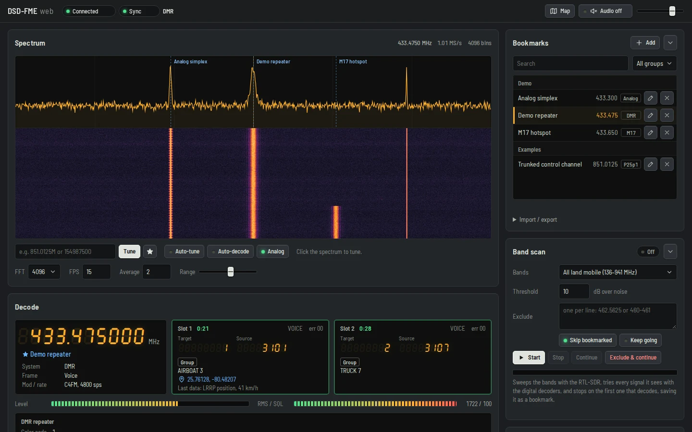
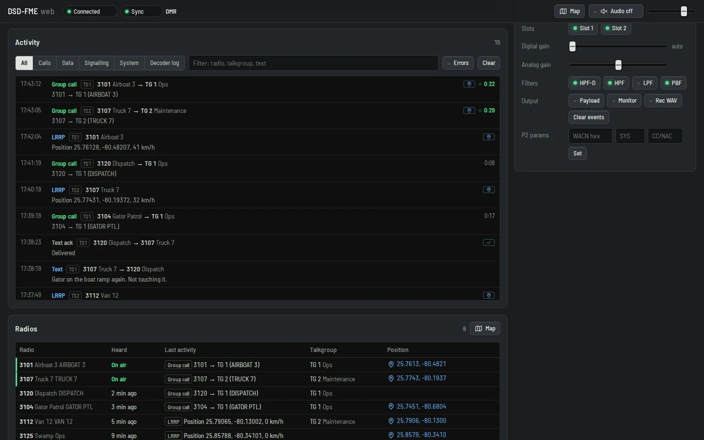
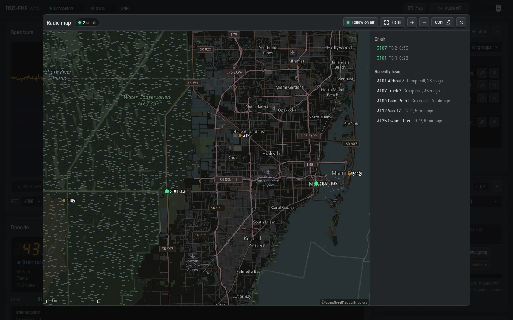
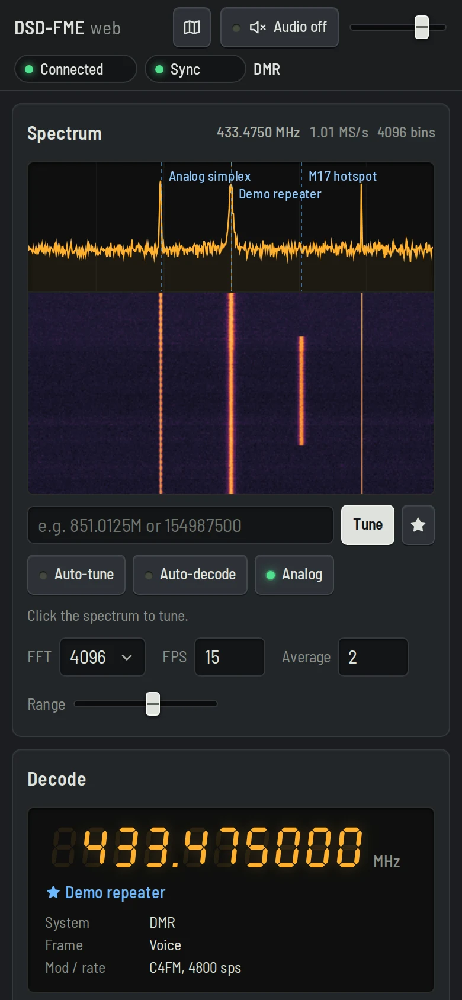

# DSD-FME web

> A hobby project, built with AI assistance. Expect some rough edges; issues and pull requests are welcome.

A fork of [DSD-FME](https://github.com/lwvmobile/dsd-fme) with a browser interface built in. Start it with `--web` and open the page:

```
dsd-fme -i rtl --web 8080      # then open http://localhost:8080/
```



## What's new in this fork

- **Web server inside dsd-fme**: `--web [bind:]port`, with an optional `--web-pass`. The page is embedded in the binary, so there's nothing else to install or run.
- **Spectrum and waterfall** from the RTL-SDR: click to tune, auto-tune onto the strongest peak, auto-decode, and a band scan that saves what it finds as bookmarks.
- **Receiver panel**: 7-segment frequency and TG/SRC readouts, per-slot call info (talker alias, GPS, last data) and the site/system picture.
- **Activity log**: calls, decoded packet data (LRRP, ARS, text messages, P25 packet data…) and signalling, with filters.
- **Radios and map**: every radio heard, positions on an OpenStreetMap map, radios on air pulse.
- **Trunking card**: follows P25 calls from the control channel, with skip, hold, block and a follow key per talkgroup.
- **Bookmarks, keys, audio and recordings**: bookmarks with groups, key entry (plus auto-find for DMR Basic Privacy), decoded audio in the browser, per-call WAV downloads.
- **Works on phones.**

Without `--web` it's the regular DSD-FME. Flags and details: [examples/Web_Interface.md](examples/Web_Interface.md).

**Radios.** RTL-SDR dongles connect directly, on this computer or over `rtl_tcp`. Other SDRs (HackRF, Airspy, SDRplay, LimeSDR…) work through SDR++, which demodulates and takes tuning commands: the page then decodes and tunes, but has no spectrum or band scan. Details: [Receivers](examples/Web_Interface.md#receivers-rtl-sdr-and-other-sdrs).

**Kept up to date with DSD-FME.** Changes to the original project ([lwvmobile/dsd-fme](https://github.com/lwvmobile/dsd-fme), branch `audio_work`) are merged in regularly, so new capabilities and fixes from DSD-FME arrive here too, with the web interface on top.

Known bugs and planned work: [TODO.md](TODO.md).

<p>
  
  
</p>
<p align="center"></p>

<sub>Screenshots use a simulated receiver and made-up demo data, no real traffic. The radios are in Florida, obviously: it's the Florida Man Edition.</sub>

---

# Digital Speech Decoder - Florida Man Edition

DSD-FME is an evolution of the original DSD project from 'DSD Author' using the base code of [szechyjs](https://github.com/szechyjs/dsd "szechyjs"), some code and ideas from [LouisErigHerve](https://github.com/LouisErigHerve/dsd "LouisErigHerve"), [Boatbod OP25](https://github.com/boatbod/op25 "Boatbod OP25") and [Osmocom OP25](https://gitea.osmocom.org/op25/op25 "Osmocom OP25"), along with other snippets of code, information, and inspirations from other projects including [DSDcc](https://github.com/f4exb/dsdcc "DSDcc"), [SDRTRunk](https://github.com/DSheirer/sdrtrunk "SDRTrunk"), [MMDVMHost](https://github.com/g4klx/MMDVMHost "MMDVMHost"), [LFSR](https://github.com/mattames/LFSR "LFSR"), [OK-DMRlib](https://github.com/OK-DMR/ok-dmrlib "OK-DMRlib"), and [EZPWD-Reed-Solomon](https://github.com/pjkundert/ezpwd-reed-solomon "EZPWD"), Eric Cottrell, SP5WWP, ilyacodes, Phillipw1084 and others. Finally, this is all brought together with original code to extend the fuctionality and add new features including NCurses Terminal and Menu system, Pulse Audio, TCP Direct Link Audio, RIGCTL, Trunking Features, LRRP/GPS Mapping, P25 Phase 2, EDACS, YSF, M17, OP25 Capture Bin compatability, etc. DSD-FME is primarily focused with Linux Desktop users in mind, so please understand that this version may not compile, compile easily, or run correctly in other environments.

This project wouldn't be possible without a few good people providing me plenty of sample audio files to run over and over again. Special thanks to jurek1111, KrisMar, noamlivne, racingfan360, iScottyBotty, LimaZulu, Forts, thewraithe2008, RayAir, Cretu, and others for the many hours of wav samples and information provided by them. Most importantly, HRH17, whose insight, information, samples, and willingness to let me remote into a computer half-way across the globe in order to test trunking features are what make DSD-FME what it has become. I'd also like to thank mrscanner2008 for providing an additional remote where additional NXDN Type-C, 'Idas' Type-D, and XPT decoding and trunking could be sorted out. Thanks to volo-zyko for cleaning up a lot of code. Thank you everybody.


## Information

See the [examples](https://github.com/lwvmobile/dsd-fme/tree/audio_work/examples "examples") folder for information on [cloning and installing](https://github.com/lwvmobile/dsd-fme/blob/audio_work/examples/Install_Notes.md "cloning and installing"), [example usage](https://github.com/lwvmobile/dsd-fme/blob/audio_work/examples/Example_Usage.md "example usage"), and [trunking examples](https://github.com/lwvmobile/dsd-fme/blob/audio_work/examples/trunking.sh "trunking examples").

## License
Copyright (C) 2010 DSD Author
GPG Key ID: 0x3F1D7FD0 (74EF 430D F7F2 0A48 FCE6  F630 FAA2 635D 3F1D 7FD0)

    Permission to use, copy, modify, and/or distribute this software for any
    purpose with or without fee is hereby granted, provided that the above
    copyright notice and this permission notice appear in all copies.

    THE SOFTWARE IS PROVIDED "AS IS" AND ISC DISCLAIMS ALL WARRANTIES WITH
    REGARD TO THIS SOFTWARE INCLUDING ALL IMPLIED WARRANTIES OF MERCHANTABILITY
    AND FITNESS.  IN NO EVENT SHALL ISC BE LIABLE FOR ANY SPECIAL, DIRECT,
    INDIRECT, OR CONSEQUENTIAL DAMAGES OR ANY DAMAGES WHATSOEVER RESULTING FROM
    LOSS OF USE, DATA OR PROFITS, WHETHER IN AN ACTION OF CONTRACT, NEGLIGENCE
    OR OTHER TORTIOUS ACTION, ARISING OUT OF OR IN CONNECTION WITH THE USE OR
    PERFORMANCE OF THIS SOFTWARE.

